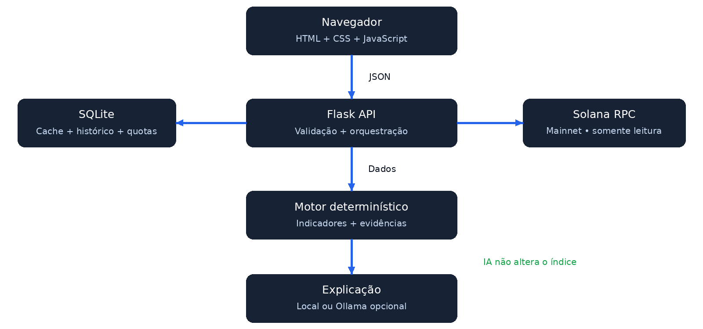

# 1 Capa

ScamShield
Know the risk before you trust.
Documentação técnica e guia de implementação
Versão 1.0 | Solana Hackathon 2026 | 7 de novembro de 2026

Este manual apresenta um MVP de leitura de atividade pública na Solana. Ele explica a arquitetura, os critérios experimentais e a execução local para quem já conhece Python e JavaScript e está começando em blockchain. O resultado é um relatório de evidências limitadas à amostra, nunca um certificado de segurança.

<!-- page -->
# 2 Resumo executivo

O ScamShield transforma uma amostra de atividade pública de um endereço Solana em indicadores explicáveis. O usuário informa somente o endereço. Flask consulta JSON-RPC, o motor determinístico identifica concentração temporal e repetição de transferências nativas de SOL, e a interface mostra evidências e lacunas de cobertura.

A versão 1.0 usa Python, Flask, Requests, SQLite, HTML, CSS e JavaScript puro. O núcleo funciona sem chave paga. A explicação por Ollama é opcional, exige configuração do operador e consentimento na consulta; sua saída é identificada como texto não verificado. O sistema não assina nem envia transações.

O principal compromisso é epistemológico: poucas observações não provam que uma conta é nova; atividade intensa não prova fraude; nenhuma regra acionada não prova segurança. O índice experimental mede somente os alertas calculáveis da amostra.

# 3 Executive Summary

ScamShield makes public Solana activity easier to inspect. A read-only Flask service retrieves a bounded transaction sample, applies transparent rules, and exposes supporting transaction links. The first release focuses on activity bursts and repeated, explicitly parsed native SOL transfers. Coverage limitations are reported separately and never add risk points.

The application requires no wallet connection, private keys or payments. Plain JavaScript renders the evidence. SQLite caches RPC responses and keeps a short local query history. Optional Ollama explanations receive selected structured metrics, do not change the score, and are labelled as unverified generated text. This is an educational anomaly inspection tool, not a calibrated fraud detector or a pre-signing transaction simulator.

# 4 Problema e justificativa

Exploradores apresentam assinaturas, contas, taxas e instruções que um iniciante pode não compreender. O problema não é falta de dados, mas a distância entre esses dados e uma interpretação verificável. A proposta reduz essa distância explicando exatamente qual comportamento foi observado e o que permanece desconhecido.

O nome ScamShield comunica a intenção preventiva; nesta versão, sua capacidade concreta é inspecionar padrões históricos. O produto não detecta todos os golpes nem bloqueia transferências. Não existe base rotulada suficiente para anunciar acurácia, precisão, recall ou probabilidade de fraude.

<!-- page -->
# 5 Público alvo e personas

| Persona | Necessidade | Resposta do MVP |
| --- | --- | --- |
| Ana, iniciante em Web3 | Entender um endereço antes de interagir | Resumo em linguagem simples e links de verificação |
| Bruno, estudante desenvolvedor | Aprender RPC e parsing sem Rust | Código pequeno, regras visíveis e testes isolados |
| Equipe de suporte de uma comunidade | Examinar atividade relatada por um usuário | Relatório JSON exportável e indicação de cobertura |

As personas são cenários de design, não entrevistas realizadas. Nenhum perfil requer associar o endereço à identidade civil do titular.

# 6 Proposta de valor e diferenciais

O diferencial proposto é reunir interpretação acessível, evidência clicável e incerteza explícita em um projeto que um iniciante consiga executar. Cada regra tem método, status, severidade, evidências e limitações. O cálculo permanece auditável mesmo se a IA estiver desligada.

O usuário consegue perceber por que o alerta apareceu e verificar as transações. Essa auditabilidade tem mais valor para o MVP do que um número opaco com aparência de precisão científica. Não se reivindica originalidade absoluta nem superioridade comercial.

# 7 Soluções existentes e concorrentes

| Solução | Foco verificado | Relação com o ScamShield |
| --- | --- | --- |
| Solana Explorer | Inspeção pública de contas e transações [S8] | Fonte para conferência independente; não é substituído |
| Phantom e Blowfish | Previews de transações e alertas antes da assinatura [S9] | Escopo mais amplo e momento diferente; o MVP inspeciona histórico |
| RugCheck | Scanner de risco de tokens Solana e Fogo [S10] | Unidade analisada diferente: token versus endereço |

O título público do RugCheck foi consultado; sua interface exige JavaScript. Não foram medidos seus algoritmos, desempenho ou cobertura. A comparação não comprova vantagem do ScamShield. Uma validação futura deve usar casos rotulados, métricas e avaliação humana independente.

# 8 Objetivos gerais e específicos

Objetivo geral: apresentar evidências compreensíveis de anomalias em uma amostra Solana, com limites explícitos. Objetivos específicos: validar Base58; consultar a Mainnet; interpretar transferências nativas simples; separar cobertura e alertas; suportar falhas do RPC; permitir reprodução de testes sem rede; oferecer explicação local em português e inglês.

<!-- page -->
# 9 Funcionalidades do MVP

O dashboard recebe um endereço, um limite entre 1 e 25 e o idioma da explicação. O backend identifica a rede pelo genesis hash, consulta metadados da conta, obtém assinaturas recentes e busca detalhes com jsonParsed. O relatório exibe indicadores, contagens, período observado, fontes e data de consulta.

O usuário pode exportar o relatório em JSON. About e How It Works explicam escopo e termos. O histórico técnico é armazenado localmente no SQLite, sem endpoint público de listagem. A IA é solicitada por checkbox e não é requisito para analisar.

# 10 Funcionalidades futuras

Token SPL e Token-2022 exigem identificação do mint, decimais, autoridades e contas associadas; ficam fora da v1. Paginação deverá informar custo e cobertura por página. Simulação antes da assinatura, grafos, listas de reputação com procedência e calibração estatística são evoluções independentes, não capacidades já entregues.

# 11 Requisitos funcionais

| ID | Requisito | Aceitação |
| --- | --- | --- |
| RF01 | Validar endereço e JSON | Rejeitar Base58 inválida, tipos incorretos e tamanhos excessivos |
| RF02 | Consultar Solana via HTTP | Usar RPC real e verificar Mainnet pelo genesis hash |
| RF03 | Analisar amostra limitada | Nunca consultar mais de 25 detalhes por análise |
| RF04 | Gerar três indicadores | Incluir cobertura sem pontos de risco |
| RF05 | Exibir evidências | Assinaturas válidas com links Explorer |
| RF06 | Explicar resultados | Fallback local sempre disponível; idioma pt ou en |
| RF07 | Usar SQLite | Cache com validade e histórico com retenção |
| RF08 | Exportar relatório | JSON baixado no navegador sem novo envio |

<!-- page -->
# 12 Requisitos não funcionais

| ID | Requisito | Limite implementado |
| --- | --- | --- |
| RN01 | Resiliência | Timeout por chamada; uma tentativa adicional em falhas transitórias |
| RN02 | Consumo previsível | Prazo de coleta de 45 s, até 25 transações e 2 análises simultâneas |
| RN03 | Proteção de recursos | JSON de até 4 KiB; 6 análises por IP/minuto e 30 globais/minuto |
| RN04 | Acessibilidade | Labels, foco visível, estados textuais e layout móvel |
| RN05 | Privacidade | Sem login, rastreadores, seeds ou IP persistente em claro |
| RN06 | Auditabilidade | Regras versionadas; logs sem URL RPC ou segredos |

O prazo de coleta é verificado entre chamadas; uma chamada já iniciada pode ultrapassá-lo pelo timeout e retry. Não constitui SLA. O navegador aguarda até 100 segundos. Estes limites visam uma demonstração com baixo tráfego.

# 13 Arquitetura de software

Aplicação monolítica modular: Flask entrega páginas e API no mesmo domínio. O cliente RPC encapsula HTTP, valida envelopes e aplica cache. O analisador é uma função pura sobre dados normalizados, facilitando testes. O explicador recebe apenas fatos selecionados e tem fallback próprio. SQLite concentra cache, histórico e contadores de proteção.

A UI nunca conhece chaves de API. Todas as URLs externas são fixas no código ou configuradas pelo operador no .env. O usuário não fornece endpoint. Não há filas, microserviços, engine de machine learning ou bibliotecas blockchain pesadas.

<!-- page -->
# 14 Comunicação entre componentes



1. O navegador envia JSON para POST /api/analyze na mesma origem.
2. Flask valida entrada, reserva limites e verifica a rede configurada.
3. O serviço busca dados no cache ou em JSON-RPC HTTPS, exclusivamente em leitura.
4. O analisador cria indicadores; o explicador local ou opcional LLM redige o resumo.
5. SQLite registra o relatório, e Flask o devolve ao frontend.

O fluxo LLM é opcional e separado da prova: nunca decide se uma regra foi acionada. Dados de cache conservam o horário de obtenção; analisá-los novamente não os torna recentes.

# 15 Tecnologias e justificativas

Python 3.12 oferece tipos, JSON, datetime e sqlite3 na biblioteca padrão. Flask fornece rotas e templates com escape automático. Requests simplifica HTTP. python-dotenv lê configurações locais. Waitress permite servir WSGI no Windows. Pytest é usado somente nos testes.

HTML, CSS e JavaScript ES6 dispensam build, npm e framework. A Fetch API chama o backend, e funções pequenas constroem componentes com textContent. A instalação usa requirements.txt com versões fixadas das dependências diretas; não equivale a um lock completo das transitivas.

<!-- page -->
# 16 Introdução à blockchain e à Solana

Blockchain é um registro compartilhado cujo estado é atualizado por transações validadas pela rede. Solana organiza esse estado em contas identificadas por endereços de 32 bytes [S7]. Um endereço Base58 válido não prova que exista saldo, pessoa, carteira ativa ou chave privada correspondente; também pode representar um programa ou PDA.

Wallet é o software que gerencia chaves e autorizações. O ScamShield precisa apenas do endereço público. Uma assinatura identifica uma transação e comprova autorização criptográfica; observar uma assinatura associada a um endereço não significa que esse endereço iniciou a operação.

RPC significa Remote Procedure Call: o programa pede a um servidor uma operação por JSON. A resposta é informação de um provedor; o MVP não executa um nó nem verifica provas criptográficas. Commitment finalized reduz a exposição a reorganizações, mas não transforma o relatório em auditoria de segurança.

Uma transação contém instruções e pode invocar outros programas por instruções internas. O saldo é medido em lamports: 1 SOL = 1.000.000.000 lamports. Taxas e múltiplas instruções fazem o saldo líquido diferir do valor de uma transferência.

# 17 Métodos JSON RPC utilizados

| Método | Parâmetros principais | Uso e cautela |
| --- | --- | --- |
| getGenesisHash | Lista vazia | Validar Mainnet; evita rotular Devnet como Mainnet |
| getAccountInfo | Endereço, finalized, base64, dataSlice vazio | Consultar owner e executable sem baixar dados da conta [S5] |
| getSignaturesForAddress | Endereço, limit, finalized | Assinaturas recentes que referenciam o endereço; não são o total histórico [S3] |
| getTransaction | Assinatura, finalized, jsonParsed, maxSupportedTransactionVersion 0 | Detalhes de legacy/v0; null é indisponibilidade, não transação inexistente [S4] |

O limite do aplicativo é 25, mesmo que o protocolo permita mais. getSignaturesForAddress permite paginação before/until, mas a v1 não a usa. O intervalo exibido usa blockTime dos registros válidos da amostra; datas ausentes ficam desconhecidas. Respostas de outros formatos ou versões não são adivinhadas.

```json
{"jsonrpc":"2.0","id":1,"method":"getTransaction",
 "params":["ASSINATURA_BASE58_64_BYTES",{
   "encoding":"jsonParsed","commitment":"finalized",
   "maxSupportedTransactionVersion":0}]}
```

O texto ASSINATURA_BASE58_64_BYTES acima é um marcador didático, não uma assinatura executável. Use scripts/live_smoke.py para obter uma assinatura real e reproduzir a consulta.

<!-- page -->
# 18 Fluxo de análise completo

Após validar JSON, endereço, limit, language e use_ai, o servidor consulta o genesis hash e metadados da conta. Se não conseguir confirmar Mainnet, encerra com erro. A ausência de conta atual não implica ausência de histórico; a consulta de assinaturas continua.

Assinaturas inválidas ou duplicadas são descartadas com contabilização. Cada detalhe deve conter a assinatura solicitada, o endereço nos accountKeys, meta.err e lista de instruções. A coleta para ao alcançar o limite, o prazo ou uma indisponibilidade generalizada. getTransaction null e erros por item tornam o relatório parcial, preservando o que foi observado.

O analisador separa transações disponíveis, falhas de execução, transferências reconhecidas e dados ausentes. O status completed indica que a coleta solicitada terminou, não que o histórico inteiro foi examinado. partial indica lacunas na coleta. Nenhuma conclusão depende de uma mensagem arbitrária do RPC.

# 19 Regras de detecção

ACTIVITY_BURST: ordena os blockTime conhecidos e encontra, com janela deslizante, o maior grupo em 60 segundos. Exige ao menos 5 assinaturas datadas e todas as assinaturas válidas da amostra com data. Aciona quando o grupo tem pelo menos 5 assinaturas e pelo menos 50% das assinaturas datadas. Severidade medium. Conta referências ao endereço, incluindo transações falhadas; não atribui autoria nem intenção.

REPETITIVE_TRANSFERS: aceita apenas instruções parsed do System Program, tipo transfer, com origem, destino e inteiro positivo em lamports, em transações bem-sucedidas. Considera instruções externas e internas, exclui autoenvios e usa apenas saídas do endereço analisado. Agrupa por origem, destino e valor exato, contando assinaturas distintas. Três transações distintas no mesmo grupo acionam medium.

Um resultado positivo de repetição precisa apenas das evidências confirmadas. Sem grupo positivo, a regra exige ao menos três transações com saídas reconhecidas e todos os detalhes disponíveis; do contrário retorna insufficient_data. Mesmo not_triggered se refere somente ao subconjunto de transferências reconhecidas. SPL, swaps, transferWithSeed e inferência por saldo líquido ficam fora do escopo.

LIMITED_OBSERVED_HISTORY: categoria coverage, severidade info. Aciona se houver menos de 10 assinaturas, intervalo inferior a 24 horas, datas ausentes, detalhes ausentes ou registros descartados. Ausência de datas impede calcular a extensão temporal. Essa regra nunca adiciona pontos. O relato descreve o período observado, não a idade da carteira.

Cada indicador contém id, title, category, description, method, status, severity, metrics, evidence e limitations. Evidence aponta para assinaturas válidas e URLs fixas do Explorer. Status pertence a triggered, not_triggered ou insufficient_data.

<!-- page -->
# 20 Índice experimental e critérios

Sejam B e R iguais a 1 quando Activity Burst e Repetitive Transfers são acionados e 0 quando calculáveis e não acionados. O Índice Experimental de Alertas é I = 50 × B + 50 × R. Limited Observed History tem peso zero.

O valor I só é publicado quando ambas as regras comportamentais são calculáveis. Se qualquer uma retorna insufficient_data, value é null; observed_points ainda informa a soma dos alertas efetivamente observados, com rótulo de valor parcial. Não se preenche a lacuna com zero e não se renormalizam os pesos.

Exemplo sintético: B = 1 e R = 0 produz 50/100. Duas regras acionadas produzem 100/100, o que significa dois critérios experimentais observados, nunca certeza de golpe. B = 1 e R desconhecido produz índice indisponível e 50 pontos observados. Sem regras calculáveis, nenhum número deve sugerir segurança.

A severidade geral é medium quando qualquer regra comportamental aciona; unknown quando faltam dados e não há acionamento; none quando ambas são calculáveis e não acionam. Não há severidade crítica na v1. Pesos e limiares são decisões de projeto, não resultados de treinamento ou validação científica.

# 21 Limitações e falsos positivos

Bots legítimos, pagamentos recorrentes, distribuição de recompensas e serviços de custódia podem produzir os mesmos padrões. Um destinatário pode receber atividade sem consentimento. Uma conta muito ativa terá uma amostra curta mesmo com anos de uso. Um fraudador pode operar lentamente e passar por todas as regras.

O parser não reconstrói todos os efeitos financeiros, não resolve identidade nem busca todo o histórico de contas de tokens associadas. Alterações de saldo podem refletir taxas, aluguel ou múltiplas instruções; por isso não são convertidas em transferências presumidas. Programas e PDAs são aceitos como endereços, mas identificados como potencialmente diferentes de carteiras pessoais.

Não há dataset de fraude rotulado nem estimativa de precisão. Para evoluir, será necessário definir classes, obter rótulos com procedência, separar treino/teste por tempo e entidade, medir falsos positivos e negativos e revisar vieses. Até lá, o produto apresenta comportamento observado e incerteza.

<!-- page -->
# 22 Estratégia de inteligência artificial

A explicação local determinística é o padrão. O módulo opcional usa a API /api/chat do Ollama, local por padrão, habilitada por LLM_ENABLED=true. LLM_URL e LLM_MODEL são configurações do operador; o usuário consente no checkbox. Modelo sugerido: qwen2.5:1.5b. Uma chave opcional LLM_API_KEY pode autenticar um proxy privado HTTPS [S11].

A IA recebe somente contagens, estados, métricas dos indicadores e limitações geradas pelo sistema. Não recebe endereço, assinaturas, memos, logs de programas, chaves ou histórico bruto. O idioma é restrito a pt/en. O prompt pede uma explicação curta sem atribuição criminal, fatos novos ou aconselhamento financeiro personalizado.

O input tem limite de 8.000 caracteres; a saída, 512 tokens e 3.000 caracteres exibidos. O contexto solicitado é de 4.096 tokens e a geração usa num_predict=512. SQLite limita a 20 tentativas diárias por instalação; falhas também consomem cota. Explicações idênticas podem usar cache de uma hora. Não há retries automáticos de LLM.

Ollama local não cobra por chamada, mas consome RAM, processamento e energia. Se o operador configurar um serviço remoto, deve controlar custos e termos desse serviço. Com IA desabilitada, timeout, resposta truncada ou cota esgotada, a aplicação retorna explicação local e informa o motivo. Nenhuma resposta de IA altera o índice, vira evidência ou é executada como código. A prevenção de alucinação é parcial: o frontend identifica o texto como gerado e não verificado.

# 23 Banco de dados

| Tabela | Campos essenciais | Finalidade |
| --- | --- | --- |
| rpc_cache | key TEXT PK, payload TEXT, fetched_at REAL, expires_at REAL | Cache RPC e explicações; chave SHA256 de namespace e parâmetros |
| analysis_history | id INTEGER PK, wallet TEXT, analyzed_at TEXT, created_at REAL, report_json TEXT | Histórico local por até 7 dias e até 500 relatórios |
| quotas | bucket TEXT PK, count INTEGER, expires_at REAL | Limites por janela e cota diária de IA |

SQLite usa WAL, timeout de escrita e transações BEGIN IMMEDIATE nos contadores. Queries SQL são parametrizadas. O cache elimina expirados e mantém até 2.000 entradas. Assinaturas e accountInfo expiram em 60 s; transações e genesis hash em uma hora. Resultados null de transação não são cacheados.

O arquivo instance/scamshield.sqlite3 é criado automaticamente e não vai no ZIP. Ele contém endereços públicos associados às consultas, informação que deve ser tratada como privada pelo operador. Não há criptografia de banco ou exclusão remota; para apagar o histórico, encerre o serviço e remova o banco e seus arquivos WAL/SHM.

<!-- page -->
# 24 Estrutura de pastas

```text
scamshield/
  app.py                 rotas e orquestração
  config.py              configuração do ambiente
  requirements.txt       dependências de execução
  requirements-dev.txt   dependências de testes
  .env.example           configuração sem segredos
  services/
    validation.py        Base58 e validação
    solana_rpc.py        HTTP, cache e coleta
    analyzer.py          regras e relatório
    ai_explainer.py      explicação local e Ollama
  database/database.py   SQLite e quotas
  templates/             três páginas e layout base
  static/css/style.css   dashboard responsivo
  static/js/app.js        Fetch e renderização segura
  scripts/live_smoke.py  leitura real opcional
  tests/                 testes isolados com mocks
  docs/                  fontes, pitch, plano e validação
```

# 25 Contratos REST

GET / renderiza o dashboard; GET /about e GET /how-it-works entregam páginas explicativas. GET /api/health retorna status, version, network e ai_configured. Esse health mede processo e acesso ao SQLite; não promete disponibilidade da blockchain ou do provedor de IA.

POST /api/analyze exige Content-Type application/json. Campos aceitos: wallet string Base58 de 32 bytes; limit inteiro de 1 a 25, padrão 25; language pt/en, padrão pt; use_ai booleano, padrão false. Campos extras, arrays como corpo e booleanos usados como números são rejeitados.

```json
{"wallet":"vines1vzrYbzLMRdu58ou5XTby4qAqVRLmqo36NKPTg",
 "limit":5,"language":"pt","use_ai":false}
```

A resposta 200 contém wallet, network, status, signatures_observed, transactions_analyzed, transactions_unavailable, successful_transactions, observed_period, account, indicators, alerts, experimental_alert_index, severity, transactions, limitations, explanation, provenance, analyzed_at, request_id e report_version.

transactions_analyzed conta detalhes estruturais válidos, incluindo falhas on-chain; successful_transactions é subconjunto. observed_period tem start/end UTC e span_seconds, que podem ser null. provenance informa source=solana_json_rpc, commitment, horários de coleta, cache_hits e coleta parcial. Nunca inclui URL RPC com chave.

<!-- page -->
## 25 Continuação dos contratos

```json
{"error":{"code":"invalid_wallet",
          "message":"Informe um endereço Base58 de 32 bytes.",
          "retryable":false},"request_id":"identificador"}
```

| HTTP | Código representativo | Comportamento |
| --- | --- | --- |
| 400 | invalid_wallet / invalid_request | Corrigir conteúdo e tipos |
| 413 | payload_too_large | Corpo excedeu 4 KiB |
| 415 | unsupported_media_type | Enviar JSON |
| 429 | rate_limited / rpc_rate_limited | Respeitar Retry-After; sem loop no frontend |
| 502 | rpc_invalid_response / rpc_error | Falha de provedor; mensagem segura |
| 503 | rpc_unavailable / busy / wrong_network | Serviço indisponível ou configuração de rede incorreta |
| 500 | internal_error | Erro inesperado sem stack trace na resposta |

Se a lista de assinaturas foi obtida e apenas detalhes falharam, o servidor retorna 200 com status partial, avisos e contagens. Isso preserva evidências sem mascarar a falha. Resposta vazia de assinaturas produz relatório com dados insuficientes, não erro de endereço nem prova de histórico vazio.

# 26 Segurança e privacidade

Não há chave privada, conexão de carteira ou método de envio. O RPC cliente tem allowlist de métodos de leitura. A URL do provedor é configurada somente no .env, usa HTTPS e não aceita redirects. O backend verifica o genesis hash esperado antes de rotular dados como Mainnet. O navegador não recebe segredos.

O frontend usa textContent e links construídos a partir de Base58 validada; não insere HTML do RPC ou LLM. Jinja escapa templates. Headers incluem CSP restritiva, X-Content-Type-Options, Referrer-Policy e frame-ancestors. JSON grande, campos desconhecidos e origens diferentes são rejeitados; CORS não é habilitado.

O rate limit usa hash com sal de processo para o IP, ignora X-Forwarded-For e usa quotas persistentes para limites globais. Reiniciar o processo reinicia a identidade hash do IP, mas não os contadores globais vigentes. ProxyFix não é ativado automaticamente. Em hospedagem, configure limites no proxy e TLS; não confie em headers do cliente.

Logs estruturados registram request_id, evento, código e duração sem endereço, body ou URL do provedor. O banco local tem acesso restrito por permissões do sistema operacional. Retenção e exclusão são responsabilidade do operador. Os controles são apropriados a um MVP, não uma certificação de segurança ou resistência a ataques distribuídos.

<!-- page -->
# 27 Estratégia de testes

Os testes unitários usam pytest, fixtures sintéticas explicitamente identificadas e mocks de transporte. Cobrem endereços, validação de JSON, conta sem transações, respostas incompletas, null, falhas de conexão, HTTP 429, retries, rede incorreta, cache, datas ausentes, repetição, rajadas, falhas on-chain e fallback de IA.

Testes negativos garantem que transferências recebidas, autoenvios, programas errados, quantias diferentes e várias instruções na mesma assinatura não sejam contadas como três envios distintos. Testes de API verificam headers, limites, exportabilidade do relatório e ausência de exposição de segredos.

scripts/live_smoke.py é separado da suíte: usa a Mainnet real com limite pequeno, grava relatório e metadados de verificação, e falha visivelmente se o RPC não responder. Dados de teste nunca alimentam o dashboard padrão. docs/VALIDATION.md registra comandos executados e resultados efetivos da entrega.

# 28 Estratégia de deploy

Para desenvolver, use python app.py em 127.0.0.1:5000 com debug desligado. Para servir via WSGI no Windows, use python -m waitress --listen=127.0.0.1:5000 app:app. Para acesso público, coloque TLS e limites de tráfego na frente do processo e configure domínio permitido [S12].

Mantenha apenas uma instância no MVP, com diretório instance em disco persistente. SQLite local, sem coordenação de semáforos entre processos, não oferece escala horizontal. Hospedagens com disco efêmero perdem cache, histórico e quotas. Um endpoint RPC dedicado melhora previsibilidade; o endpoint público continua sendo opção de demonstração, sujeito a bloqueios [S6].

Não publique .env, banco, capturas privadas ou chaves em Git. Use variáveis do provedor. Antes de publicar, execute testes, uma consulta real, teste móvel e verifique redaction dos logs. A entrega inclui código de deploy; nenhuma hospedagem é criada automaticamente.

# 29 Riscos e contingência

| Risco | Impacto | Resposta |
| --- | --- | --- |
| RPC bloqueado ou 429 | Demonstração sem detalhes | Reduzir limit, aguardar Retry-After ou configurar outro RPC Mainnet |
| IA falha ou desabilitada | Sem texto generativo | Explicação local rotulada e núcleo funcional |
| Poucos dados interpretáveis | Índice indisponível | Mostrar cobertura e evidências obtidas |
| Falso positivo | Interpretação injusta | Linguagem de comportamento; nunca acusação |
| Falha de rede durante vídeo | Demo interrompida | Usar relatório real capturado com data visível, declarado como gravação |
| Regras de elegibilidade incertas | Inscrição inadequada | Conferir portal e organização; não declarar premiação garantida |

<!-- page -->
# 30 Cronograma de desenvolvimento

| Janela | Entrega prioritária | Dependência |
| --- | --- | --- |
| H0–H4 | Regras, escopo, arquitetura e documentação | Nenhuma |
| H4–H10 | RPC, validação, SQLite | Escopo fechado |
| H10–H18 | Parser e indicadores testados | Contrato dos dados |
| H18–H28 | Dashboard, erros e exportação | API funcional |
| H28–H34 | Segurança e testes de integração | Fluxo completo |
| H34–H38 | IA opcional e fallback | Evidências estáveis |
| H38–H44 | Consulta real, revisão e vídeo | MVP testado |
| H44–H47h45 | Submissão e contingência | Código e vídeo prontos |

Este é um plano de até 48 horas, não um relato de horas trabalhadas. Como o evento já começou, priorize P0 e elimine extras. O prazo de submissão da página prevalece sobre o planejamento.

Na agenda oficial [S1], o início é 6/11 às 14h de São Paulo; em 8/11, a submissão inicial é às 12h e a final às 13h45. A janela de desenvolvimento divulgada é de 47h45. Encerramento às 14h. Horários convertidos de EST para America/Sao_Paulo.

# 31 Critérios objetivos de conclusão

O MVP está tecnicamente aceito quando Flask inicia, as três páginas abrem, endereço válido gera consulta real, ao menos uma amostra real passa pelo motor e o relatório mostra fontes, contagens e limitações. A suíte de testes precisa passar sem depender da rede. Falhas RPC devem virar mensagens visíveis; ausência de IA deve continuar produzindo explicação.

Critérios de qualidade adicionais: nenhuma URL ou chave privada entra pelo formulário; exports preservam data e origem; valores desconhecidos não viram zero; tela móvel não tem rolagem horizontal; nenhuma resposta de IA controla lógica ou cria evidência. Aprovação técnica não estabelece elegibilidade na competição.

# 32 Apresentação para jurados

Mostre o aplicativo funcionando e abra uma evidência no Explorer. Explique por que leitura de dados Solana é essencial: os indicadores dependem de assinaturas, horários e instruções on-chain. Não justifique o projeto por velocidade de pagamentos, pois o MVP não efetua pagamentos.

Para AI Track, demonstre uma resposta real do módulo configurado e a separação entre fatos e explicação. Fallback local não é IA e não basta para afirmar que IA faz trabalho real. Para Beginner, confirme a composição da equipe; a página exige mais de 50% de first-time hackers [S1]. Não atribua um prêmio ou taxa de sucesso prevista ao projeto.

<!-- page -->
# 33 Demonstração de dois minutos

| Tempo | Ação e mensagem |
| --- | --- |
| 0–15 s | Dizer nome do evento e mostrar problema: dados públicos difíceis de interpretar |
| 15–35 s | Inserir endereço público de exemplo, limite 5 ou 10 e iniciar análise |
| 35–60 s | Apontar contagens e intervalo; diferenciar amostra de histórico total |
| 60–85 s | Abrir um indicador e seu link verificável; não prometer alerta predeterminado |
| 85–105 s | Mostrar explicação local ou Ollama real, com rótulo correto |
| 105–120 s | Explicar limites, ausência de assinaturas/pagamentos e próxima evolução |

Endereço de demonstração: vines1vzrYbzLMRdu58ou5XTby4qAqVRLmqo36NKPTg, publicado em exemplo oficial de getAccountInfo [S5]. O uso não implica titularidade, reputação ou suspeita. Resultado esperado: validação correta e relatório com o que o RPC retornar; quantidades e alertas podem mudar.

Para uma apresentação reproduzível, gere um relatório real com scripts/live_smoke.py próximo da gravação. Se usar o snapshot incluído, diga a data exibida e que é captura histórica. Nunca exiba fixtures sintéticas como uma consulta ao vivo. O pitch e o texto de submissão estão em docs/PITCH.md.

# 34 Roadmap e participação

v1.1: paginação controlada, exportação PDF e interpretação SPL com testes. v1.2: múltiplas amostras temporais, avaliação rotulada e perfis de atividade legítima. v2: simulação pré-assinatura isolada, integrações com carteiras e revisão de reputação com direito de contestação. Cada etapa precisa de critérios próprios de segurança e mensuração.

Regras consultadas em 7/11/2026: a página do evento confirma Top 3 Overall, AI Track e Beginner; exige consentimento parental para menores. O regulamento padrão MLH permite assistência de IA com transparência, restringe trabalho anterior e pede vídeo público de até dois minutos em eventos digitais [S1, S2]. O material gerado nesta entrega deve ser declarado, revisado e compreendido pela equipe.

O documento geral de Contest Terms encontrado se refere à temporada encerrada em junho de 2026; não resolve sozinho elegibilidade territorial ou pagamento de prêmios neste evento de novembro [S13]. Confirme termos vigentes no portal/organização. O código e vídeo não foram submetidos automaticamente. Use MLH Challenges, destino apontado pela agenda; campos no estilo Devpost são apenas formato de preparação.

<!-- page -->
# 35 Referências oficiais

Fontes consultadas em 7 de novembro de 2026. Links de documentação podem mudar. Regras específicas atualizadas do evento prevalecem sobre o regulamento geral.

S1. MLH. Solana Hackathon, agenda, trilhas e formulário.
https://events.mlh.com/events/15200-solana-hackathon

S2. MLH. Standard Hackathon Rules, incluindo AI Tools e Digital Event Submission Rules.
https://github.com/MLH/mlh-policies/blob/main/standard-hackathon-rules.md

S3. Solana. getSignaturesForAddress.
https://solana.com/docs/rpc/http/getsignaturesforaddress

S4. Solana. getTransaction e estruturas JSON.
https://solana.com/docs/rpc/http/gettransaction
https://solana.com/docs/rpc/json-structures

S5. Solana. getAccountInfo.
https://solana.com/docs/rpc/http/getaccountinfo

S6. Solana. Clusters and Public RPC Endpoints.
https://solana.com/docs/references/clusters

S7. Solana. Accounts e getGenesisHash.
https://solana.com/docs/core/accounts
https://solana.com/docs/rpc/http/getgenesishash

S8. Solana Explorer.
https://explorer.solana.com/

S9. Phantom. Security at Phantom.
https://phantom.com/learn/blog/security-at-phantom

S10. RugCheck. Site oficial e identificação pública do produto.
https://rugcheck.xyz/

S11. Ollama. Chat API, instalação Windows e modelo Qwen2.5.
https://docs.ollama.com/api/chat
https://docs.ollama.com/windows
https://ollama.com/library/qwen2.5:1.5b

S12. Pallets. Deploying to Production.
https://flask.palletsprojects.com/en/stable/deploying/

S13. MLH. Contest Terms, versão com temporada 2025–2026.
https://github.com/MLH/mlh-policies/blob/main/contest-terms.md
